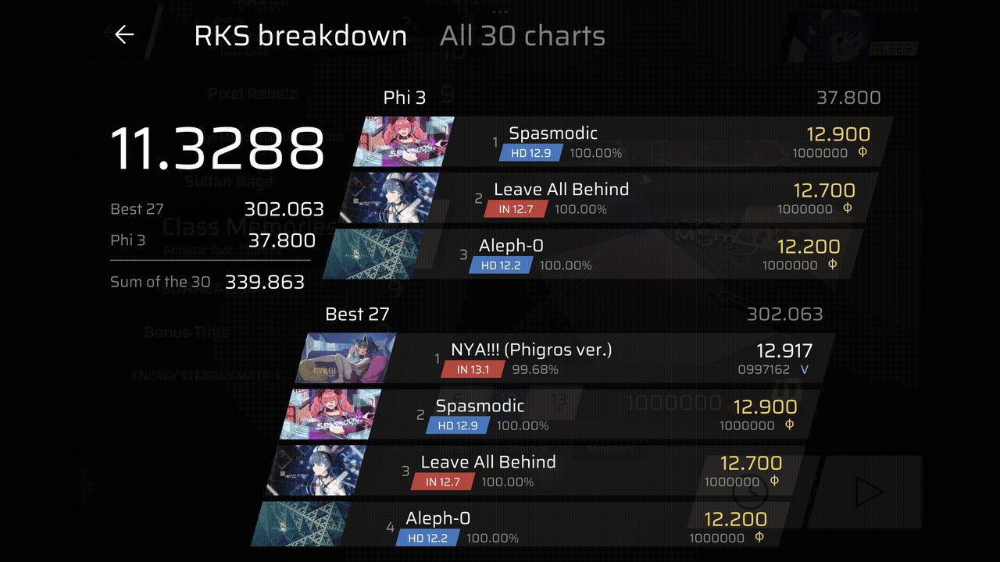
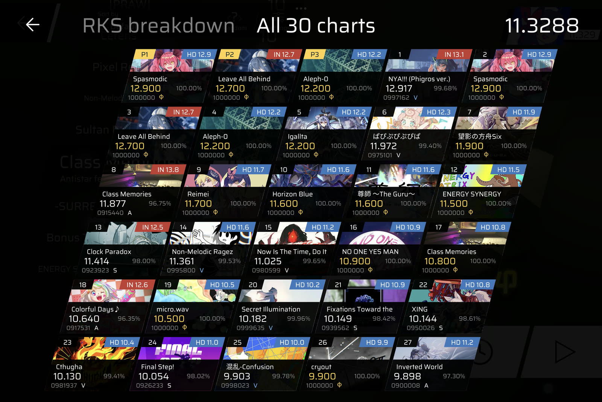

# RKS breakdown

A mod for [Phigros++](https://github.com/ggmolly/PhigrosPlusPlus) that shows what your RKS is made of when you tap it on the song list: your 3 best all perfect charts and your 27 best charts, with what each one counts for.

## Install

Open the **Mods** tab of the game's settings and pick RKS breakdown in the catalog, or open [this link](phigrospp://install/ggmolly/phigrospp-rks-breakdown) on the device.

It needs Phigros++ 0.3.0-beta.16 or newer.

## What it shows

Tap the RKS next to your avatar on the song list. The avatar itself keeps doing what it did.

| Tab | |
|---|---|
| RKS breakdown | The RKS with four decimals and the sums behind it, then a list of the Phi 3, the Best 27 and the 10 charts that would count next |
| All 30 charts | The Phi 3 (P1 to P3) and the Best 27 on one screen |

Every chart comes with its level and constant, your accuracy, score and grade, and its RKS, in gold once the chart is all perfect.

## How it works

A chart's RKS is its constant × ((accuracy − 55) / 45)², and nothing under 70%. The game adds the 27 highest to the 3 highest among your all perfect charts, which count twice then, and divides the sum by 30.

The mod reads your records and the constants from the game and does the same sum, so it always matches the RKS the game shows. Nothing is saved and nothing in the game changes. It hooks no game method, so it works on iOS without JIT.
